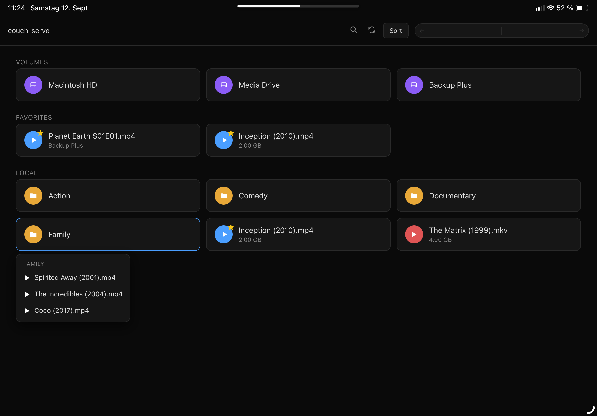

# couch-serve

Stream videos from your Mac to your iPad over the local network. No accounts, no library scan, no setup ceremony. Point it at a folder and open the browser.



## Quick start

```bash
npm install
node server.js ~/Movies
```

Open `http://<your-mac-ip>:8080` on your iPad (or any browser).

## Features

- **Browse folders** as they are, no reorganizing required
- **Direct streaming** for MP4, M4V, MOV (range requests, instant seeking)
- **On-the-fly HLS transcoding** for everything else (AVI, MKV, FLV, WMV, MPEG, WebM, VOB, etc.) via FFmpeg
- **Volume picker** showing all mounted drives on the start page
- **Search** across current folder and subfolders (5 levels deep)
- **Sort** by name, date, or size (folders and files)
- **Favorites** with star badges, scoped per media directory and volume
- **iPad gestures**: double-tap to skip 10s, loop toggle, native fullscreen
- **Home screen web app** support with safe-area insets
- **Browser history** and hash-based state (refresh remembers where you were)
- **Symlink support**

## Requirements

- Node.js
- [FFmpeg](https://ffmpeg.org/) on PATH (only needed for non-MP4 formats)

## Usage

```
node server.js [media-dir] [options]

Options:
  --port <n>   Port to listen on (default: 8080, or PORT env)
  --host <mode> Which interface(s) to bind, IPv4 only (default: auto,
                 or HOSTS env; --hosts is an alias):
                 auto        loopback + LAN IP + Bonjour .local name
                             + Tailscale IP/DNS when present
                 localhost   loopback only, not reachable from other devices
                 <csv>       explicit IPs/hostnames,
                             e.g. 192.168.1.10,my-mac.local
                 0.0.0.0     all interfaces (previous behavior, least secure)
  --demo       Launch with fake data for screenshots
  --help, -h   Show this help
```

```bash
node server.js ~/Movies
node server.js ~/Movies --port 3000
node server.js ~/Movies --host localhost
node server.js ~/Movies --host 192.168.1.10,my-mac.local
node server.js /Volumes/External
node server.js --demo
```

Just run it and it works on your local network (e.g. from an iPad):
by default the server binds loopback, the primary LAN IP, the Bonjour
`.local` name, and — when Tailscale is installed — the Tailscale IP and
MagicDNS name, instead of `0.0.0.0`. That keeps the zero-config charm
while no longer listening on every interface. Binding is IPv4-only.
Pass `--host` (`--hosts` works too, or `HOSTS`
env) to override; `auto` may also be mixed into a list
(e.g. `--host auto,10.0.0.5`), and `--host 0.0.0.0` restores binding to
all interfaces.

The server is a single file (`server.js`). No build step, no config file, no database. HLS temp files are cleaned up automatically on stop, shutdown, or after 5 minutes of inactivity.

## How transcoding works

Files Safari can play natively (MP4, M4V, MOV) are streamed directly with HTTP range requests. Everything else goes through FFmpeg, which converts to H.264/AAC HLS segments on the fly. Safari pulls the segments as they're produced, so playback starts within seconds while the rest of the file is still converting.

## License

MIT
